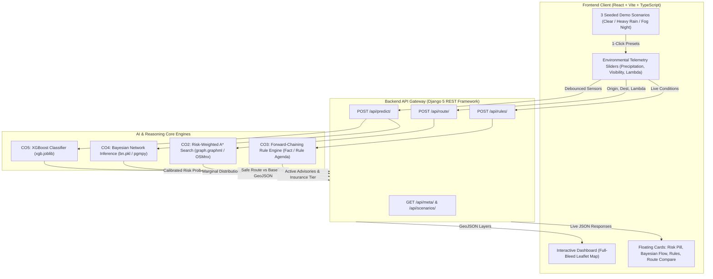

# SafeRoute AI: Risk-Aware Routing via Causal Inference & Dynamic Pathfinding

> **Micro Project 14**: AI-Based Road Accident Prediction (Traffic Management & Insurance Underwriting)  
> **Integrated Course Outcomes**: CO1 (Agent PEAS), CO2 (Risk-Weighted A* Search & Dijkstra), CO3 (Rule-Based Expert System), CO4 (Probabilistic Reasoning via Bayesian Network), CO5 (Supervised ML with XGBoost).

---

## 1. Executive Summary

SafeRoute AI is a comprehensive transportation analytics platform that moves beyond static accident classification to **dynamic, risk-aware pathfinding**. Rather than optimizing solely for shortest distance or fastest speed, SafeRoute deploys a **Goal-Based Utility Agent** that balances travel latency against accident risk exposure.

When adverse environmental conditions arise (heavy rain, zero-visibility fog, nocturnal congestion), SafeRoute:
1. Evaluates calibrated marginal probabilities via a **Bayesian Network DAG** (`pgmpy`) and **XGBoost**.
2. Dynamically penalizes road network edges:

```
cost(u, v) = length(u, v) * (1 + lambda * edge_risk * env_multiplier)
```

$$\mathrm{cost}(u, v) = \mathrm{length}(u, v) \times \left(1 + \lambda \times \mathrm{risk}(u, v) \times M_{\mathrm{env}}\right)$$

3. Recalculates paths using **Risk-Weighted A\*** with an admissible Haversine heuristic ($h \le \mathrm{cost}$), finding detours around high-hazard bottlenecks.
4. Executes a **forward-chaining production rule engine** to output operational traffic advisories and insurance underwriting tiers.

---

## 2. Course Outcomes (CO1 – CO5) Mapping Table

| Course Outcome | Academic Concept | Implementation in SafeRoute AI | Primary Artifact / Code Symbol |
| :--- | :--- | :--- | :--- |
| **CO1** | **Intelligent Agent Models** | Goal-Based Utility Agent balancing travel efficiency against accident hazard exposure (PEAS Profile). | [`docs/peas.md`](file:///c:/Users/LENOVO/Documents/KITS/Semester%203/AI/IA3/docs/peas.md), [`App.tsx`](file:///c:/Users/LENOVO/Documents/KITS/Semester%203/AI/IA3/frontend/src/App.tsx) |
| **CO2** | **Informed & Uninformed Search** | Risk-weighted A* pathfinding with admissible Haversine heuristic ($h \le \mathrm{cost}$) vs Dijkstra baseline. | [`routing/astar.py`](file:///c:/Users/LENOVO/Documents/KITS/Semester%203/AI/IA3/backend/routing/astar.py), [`MapView.tsx`](file:///c:/Users/LENOVO/Documents/KITS/Semester%203/AI/IA3/frontend/src/components/MapView.tsx) |
| **CO3** | **Knowledge Representation & Reasoning** | Pure-Python forward-chaining production rule engine (Working Memory + Agenda) firing traffic advisories & actuarial tiers. | [`rules/engine.py`](file:///c:/Users/LENOVO/Documents/KITS/Semester%203/AI/IA3/backend/rules/engine.py), [`RuleAdvisoriesCard.tsx`](file:///c:/Users/LENOVO/Documents/KITS/Semester%203/AI/IA3/frontend/src/components/RuleAdvisoriesCard.tsx) |
| **CO4** | **Probabilistic Reasoning under Uncertainty** | Causal Bayesian Network DAG with learned CPTs via Dirichlet prior smoothing; marginals & Pearl's do-calculus. | [`bn/infer.py`](file:///c:/Users/LENOVO/Documents/KITS/Semester%203/AI/IA3/backend/bn/infer.py), [`BayesianNetworkCard.tsx`](file:///c:/Users/LENOVO/Documents/KITS/Semester%203/AI/IA3/frontend/src/components/BayesianNetworkCard.tsx) |
| **CO5** | **Supervised Machine Learning Techniques** | Calibrated XGBoost classifier trained on historical US traffic accident records (n ≤ 100k, Austin, TX). | [`ml/edge_risk.py`](file:///c:/Users/LENOVO/Documents/KITS/Semester%203/AI/IA3/backend/ml/edge_risk.py), [`RiskCard.tsx`](file:///c:/Users/LENOVO/Documents/KITS/Semester%203/AI/IA3/frontend/src/components/RiskCard.tsx) |

---

## 3. System Architecture Diagram



---

## 4. Single-Command Quick Start

SafeRoute AI includes unified start scripts for all major operating systems:

### Option A: Windows PowerShell (Recommended)
```powershell
.\start.ps1
```
*Automatically validates Python virtual environment, runs migrations, verifies models, launches Django on `http://localhost:8000`, starts Vite on `http://localhost:5173`, and opens the browser.*

### Option B: Windows Command Prompt (Batch)
```cmd
start.bat
```

### Option C: Linux / macOS (Bash)
```bash
chmod +x start.sh
./start.sh
```

### Option D: Makefile
```bash
make start       # Starts both servers
make test        # Runs backend test suite
make backend     # Runs Django REST backend only
make frontend    # Runs React Vite frontend only
```

### Option E: Docker Compose
```bash
docker compose up --build
```
*Access frontend at `http://localhost:5173` and backend at `http://localhost:8000`.*

---

## 5. Seeded Demo Scenarios (1-Click Viva Presets)

The system includes **3 pre-seeded demonstration scenarios** accessible via 1-click buttons in the **Environmental Controls Panel** or via automated playback with the **"Demo Mode"** button in the header:

| Scenario | Environmental Profile | AI Agent Behavior | Rule Advisories & Underwriting |
| :--- | :--- | :--- | :--- |
| **1. Optimal Daylight** | Sunny, clear sky, 10 mi visibility, 25% traffic density, λ = 1.0. | Baseline risk score is low (≈ 2.5%). A* and fastest route coincide. | **Tier A (Preferred)**. Base rate (-5% discount). Zero critical advisories. |
| **2. Heavy Rainstorm** | 0.85 in/hr downpour, 3.5 mi visibility, 65% rush-hour traffic, λ = 2.5. | Friction drop elevates I-35 corridor risk. A* path safely detours along urban arterials. | **Tier C (High Hazard)**. Hydroplaning mandate speed reduction to 35 mph. |
| **3. Dense Fog at Night** | 0.8 mi visibility, midnight (23:00), 80% stop-and-go congestion, λ = 3.8. | Bayesian network infers critical compound hazard. A* avoids high-crash junctions. | **Tier D (Referral)**. Dense fog warning + high pedestrian hazard surcharge (+110%). |

---

## 6. Screenshots & Viva Presentation Instructions

Follow this sequence during your evaluator presentation or viva:

1. **Baseline View (Scenario 1)**:
   - Click **"☀️ Clear"** in the Controls panel.
   - Show that the Risk Card pill is **cold blue** (&lt; 25%).
   - Point out that the green Safest route matches the fastest route, showing 0% detour overhead.
   - Show the Rule Advisories Card displaying **Tier A (Preferred Driver)**.
2. **Dynamic Risk-Avoidance Detour (Scenario 2)**:
   - Click **"🌧️ Heavy Rain"** (or slide precipitation to 0.85 in/hr).
   - Observe the Bayesian Network card animating marginal probability bars (Road Surface becomes 99.8% Wet).
   - Observe the **Mint Discount-Badge** in the Route Comparison card: *"-48% Risk Exposure"* with a +0.3 mi detour.
   - Show the map: the green A* path diverts away from the red I-35 high-risk accident blackspot.
   - Show the **R01_HYDROPLANING** critical advisory card triggered.
3. **Compound Extreme Uncertainty (Scenario 3)**:
   - Click **"🌫️ Fog Night"** (or slide visibility to 0.8 mi and hour to 23).
   - The Risk pill turns **hot red** (&gt; 75%).
   - Underwriting Tier changes to **Tier D (Refer to Senior Underwriter)** with a +110% hazard surcharge.
4. **Interactive Map Pinning**:
   - Click anywhere on the Austin map to set **Point A (Origin)**, then click elsewhere to set **Point B (Destination)**.
   - Watch the backend compute the new risk-weighted A* path in real-time (&lt; 350 ms).

---

## 7. Project Structure

```text
├── backend/
│   ├── api/                 # Django REST endpoints (/health, /meta, /scenarios, /predict, /route, /rules)
│   ├── config/              # Django settings, CORS headers, URLs
│   ├── ml/                  # XGBoost tabular model & OSM edge risk calculator (CO5)
│   ├── bn/                  # Bayesian Network inference engine & CPT learner (CO4)
│   ├── rules/               # Production rule engine with working memory & agenda (CO3)
│   ├── routing/             # Road graph cache & risk-weighted A* search (CO2)
│   ├── data/                # Cleaned sampled dataset (clean.parquet)
│   └── models/              # Pretrained models (xgb.joblib, bn.pkl, graph.graphml)
├── frontend/
│   ├── src/
│   │   ├── components/      # MapView (Leaflet), BayesianFlow, RiskCard, RuleCard, ComparisonCard
│   │   ├── api/             # client.ts (live fetch at http://localhost:8000), types.ts
│   │   └── styles/          # Tailwind tokens & Design system
│   ├── package.json
│   └── vite.config.ts
├── docs/                    # PEAS specification and evaluation artifacts
├── start.ps1                # PowerShell single-start script
├── start.bat                # Windows batch single-start script
├── start.sh                 # Unix bash single-start script
├── Makefile                 # Make automation targets
├── docker-compose.yml       # Container orchestration
└── requirements.txt         # Pinned Python dependencies
```

---

## 8. License

Developed for Academic Micro Project 14 (AI-Based Road Accident Prediction). Open source under the MIT License.
