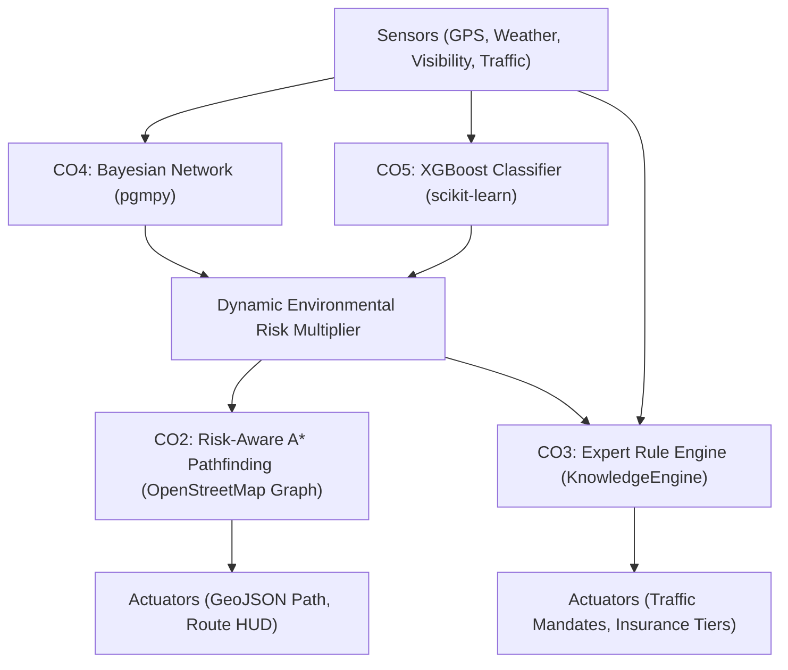

# SafeRoute AI — Agent PEAS Framework & Decision Architecture

**Course Outcome:** CO1 (Intelligent Agent Models)  
**Project:** Micro Project 14 – AI-Based Road Accident Prediction (Traffic Management / Insurance)  
**Agent Architecture:** Goal-Based Utility Agent with Causal Uncertainty Reasoning  

---

## 1. PEAS Framework Specification

The SafeRoute AI agent is modeled as an **Intelligent Goal-Based Utility Agent** operating in a dynamic, stochastic urban transportation environment. The PEAS breakdown is formalized below:

| Dimension | Description | Operational Realization in SafeRoute AI |
| :--- | :--- | :--- |
| **Performance Measure (P)** | Quantitative utility function balancing passenger safety, travel delay, and insurance liability. | • **Minimize Total Cost:** $U = -\sum_{e \in \text{path}} \left[ \text{length}(e) \cdot (1 + \lambda \cdot \text{edge\_risk}(e) \cdot \text{env\_multiplier}) \right]$ • **Accident Risk Reduction:** Percentage reduction in severe accident exposure relative to shortest path. • **Travel Efficiency:** Travel distance delta ($\Delta d$) and duration delta ($\Delta t$). • **Actuarial Calibration:** Alignment of insurance underwriting tier ($0.95\times$ to $2.10\times$) with actuarial loss probability. |
| **Environment (E)** | Urban road network subject to stochastic weather, dynamic congestion, and diurnal cycles. | • **Road Network Topology:** Directed multigraph $G = (V, E)$ obtained from OpenStreetMap via OSMnx (Austin, TX urban core). • **Historical Accident Distribution:** Spatial grid aggregations from the US Accidents dataset (Austin, TX subset). • **Stochastic Atmosphere:** Dynamic precipitation, visibility, ambient lighting, and temperature. • **Traffic States:** Variable vehicle density and shockwave propensities. |
| **Actuators (A)** | Mechanisms through which the agent influences the environment and guides human operators. | • **Risk-Aware Routing Engine:** Dynamic A* path calculation generating GeoJSON LineStrings for vehicle navigation systems. • **Traffic Management Directives:** Active speed reductions (e.g. 35 mph hydroplaning mandate), lane closures, and heavy vehicle diversion advisories. • **Dynamic Insurance Multipliers:** Actuarial tier assignments (Tier A through Tier D) with automated premium adjustments for commercial fleets. • **Visual Cockpit / Heatmap Overlays:** Interactive frontend map rendering high-risk conflict zones. |
| **Sensors (S)** | Information intake channels capturing state observations from physical and digital telemetry. | • **Geospatial Fixes:** GPS coordinates for vehicle origin $(lat_{orig}, lon_{orig})$ and destination $(lat_{dest}, lon_{dest})$. • **Meteorological Telemetry:** Real-time precipitation rate (in/hr), visibility range (miles), weather category (Clear, Rain, Fog, Snow), and road surface moisture. • **Temporal Clocks:** System hour of day ($0 \dots 23$), day of week ($0 \dots 6$), and diurnal phase (Day, Dusk, Night). • **Traffic Flow Detectors:** Segment vehicular density percentage ($0 \dots 100\%$) and intersection signal states. |

---

## 2. Environment Properties Classification

According to Russell & Norvig's agent environment taxonomy, the SafeRoute AI operating domain exhibits the following structural properties:

1. **Partially Observable:** While the physical road graph is known, the exact friction coefficient of the pavement, sudden microburst rainfalls, and driver distractions remain unobserved, necessitating probabilistic inference (CO4) and supervised risk estimation (CO5).
2. **Stochastic:** The occurrence and severity of accidents are non-deterministic. Identical road segments under identical weather may or may not produce a collision, characterized by conditional probabilities $P(\text{Severity} \mid \text{Weather}, \text{Traffic}, \dots)$.
3. **Sequential:** Decisions made early in a journey (e.g., opting for an expressway vs. an arterial bypass) dictate the downstream exposure to hazards and congestion downstream.
4. **Dynamic:** Environmental variables (visibility, rainfall intensity, dusk twilight glare) change while the agent is planning and executing routes.
5. **Continuous:** Spatial coordinates $(lat, lon)$, precipitation rates, and risk probabilities vary across continuous numerical domains.
6. **Multi-Agent:** The road is populated by thousands of autonomous and human-driven vehicles, pedestrians, and emergency services. SafeRoute AI coordinates utility at both the individual driver level (rerouting) and systemic traffic management level (lane closures).

---

## 3. Agent Utility Function & Search Formulation (CO1 $\rightarrow$ CO2)

Unlike a simple **Reflex Agent** or **Goal-Only Agent** (which merely seeks *any* path connecting origin to destination), SafeRoute AI is a **Goal-Based Utility Agent**:

$$\text{Utility}(R) = - \sum_{e \in R} \text{cost}(e)$$

where the risk-penalized edge cost is:

$$\text{cost}(e) = \text{length}(e) \times \left(1 + \lambda \times \text{edge\_risk}(e) \times \text{env\_multiplier}\right)$$

- $\lambda \in [0.0, 5.0]$: The passenger's parameterized **risk-aversion utility preference**.
  - When $\lambda = 0$: The agent degrades to a pure distance-minimizing agent (fastest path).
  - When $\lambda > 0$: The agent trades additional travel distance for substantial reductions in accident probability.
- $\text{env\_multiplier}$: Causal multiplier computed from Bayesian Network marginal inference $P(\text{Severity} = \text{High} \mid \mathbf{E})$ and calibrated XGBoost risk.

---

## 4. Synthesis with Integrated Course Outcomes

1. **CO1 (Agent Models):** Defines the overarching PEAS specification, utility tradeoff model, and state-perception loop.
2. **CO2 (Search):** Formulates informed A* pathfinding with an admissible haversine heuristic that penalizes high-risk edges while guaranteeing optimal utility search.
3. **CO3 (Knowledge Representation):** Production rules match environmental facts and risk probabilities to generate transparent, explainable operational advisories.
4. **CO4 (Probabilistic Reasoning):** Handles sensor uncertainty and causal counterfactual intervention (`do(RoadSurface = Dry)`).
5. **CO5 (Machine Learning):** Learns non-linear interactions from historical tabular crash records to predict calibrated baseline probabilities.
